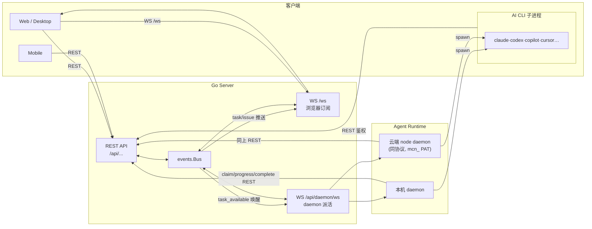
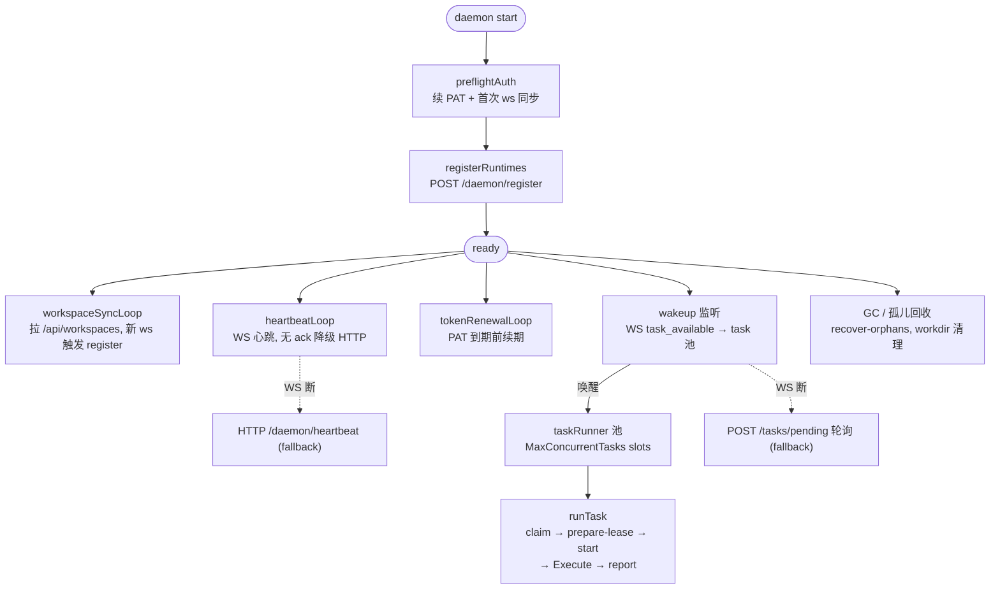

# Multica 架构精要（三图版）

> 只讲三件事：**各端如何交互**、**daemon 主循环怎么转**、**多种 AI CLI 怎么被统一抽象**。
> 配置、部署、细节一律略过。代码引用均可点击跳转。

---

## 1. 各端交互

客户端通过 REST + 一条 WS 看结果；daemon 通过 REST + 另一条 WS 拿活并回报。`events.Bus` 把两路串起来。



三条关键交互线：

- **浏览器 ↔ server**：REST 写、`/ws` 订阅读。task 事件经 `events.Bus` 进 `/ws` 广播。
- **daemon ↔ server**：WS 收“有活”唤醒，REST `claim` 原子抢占、`progress/complete` 回报。云端 node 回连后路径完全一致。
- **daemon → AI CLI**：daemon 是宿主，spawn 本机或云端 CLI 子进程跑实际任务。

---

## 2. Daemon 主循环

[`Daemon.Run`](../server/internal/daemon/daemon.go#L724) 启动后由若干并发子循环构成：WS 优先、HTTP 兜底，task slot 池控并发。



要点：

- **唤醒 ≠ 认领**：WS 唤醒只是提示，真正拿到 task 靠 REST `claim`，保证多 daemon 不重复执行。
- **WS 优先 HTTP 兜底**：心跳和唤醒都先走 WS，丢 ack / 断线才回退 HTTP，降负载又不丢正确性。
- **slot 池控并发**：`MaxConcurrentTasks` 个 slot 各跑一次 `runTask`，claim 失败就回睡眠等下一轮。

---

## 3. Agent Backend 统一抽象

[`server/pkg/agent`](../server/pkg/agent/agent.go) 把 16 种 CLI 收敛成一个 `Backend` 接口，`runTask` 只对接它 —— 加新 CLI 不动调度链。

```mermaid
classDiagram
  class Backend {
    <<interface>>
    +Execute(ctx, prompt, ExecOptions) Session
  }
  class ExecOptions {
    Cwd, Model, SystemPrompt
    McpConfig, ThinkingLevel
    ResumeSessionID, CustomArgs
  }
  class Session {
    Messages ~chan~Message
    Result ~chan~Result
  }
  class Result {
    Status, Output, SessionID
    Usage map~string,TokenUsage~
  }

  Backend <|.. Claude
  Backend <|.. Codex
  Backend <|.. Copilot
  Backend <|.. Cursor
  Backend <|.. Hermes
  Backend <|.. Others["Dimcli·Openclaw·Opencode<br/>Kimi·Kiro·Pi·Qoder·Traecli<br/>Codebuddy·Antigravity"]

  Backend ..> ExecOptions
  Backend ..> Session
  Session ..> Result
```

要点：

- **归一输出**：所有后端都产出 `Message` 事件流 + `Result` 终态，daemon 的进度回报 / usage 统计与具体 CLI 解耦。
- **白名单同源**：`SupportedTypes` 与 DB `runtime_profile.protocol_family` CHECK 约束一致，`agent.New(type)` 据此选后端。
- **自定义 runtime 只换二进制**：profile 覆盖 `ExecutablePath + CustomArgs`，protocol_family 仍决定参数注入逻辑，后端复用。
