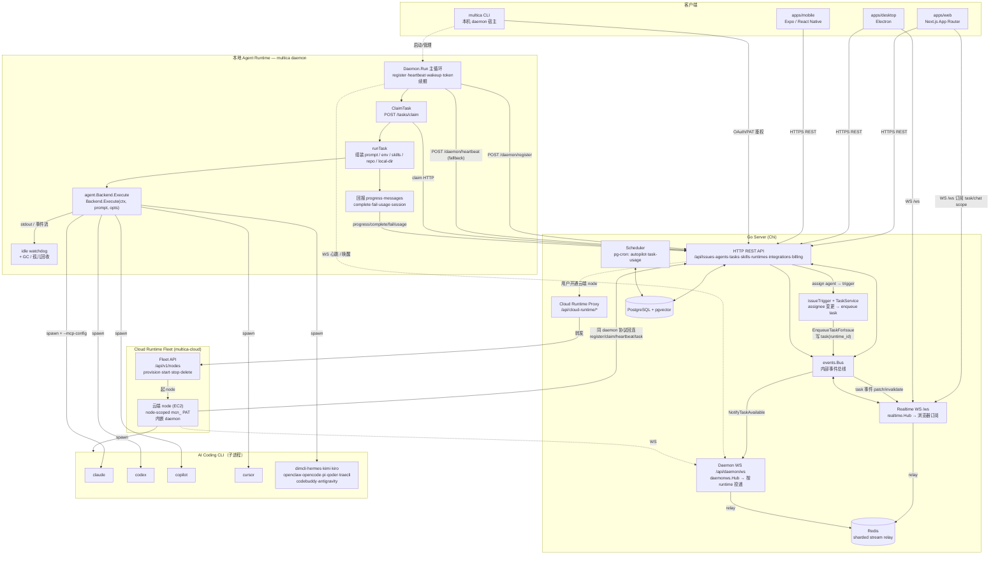
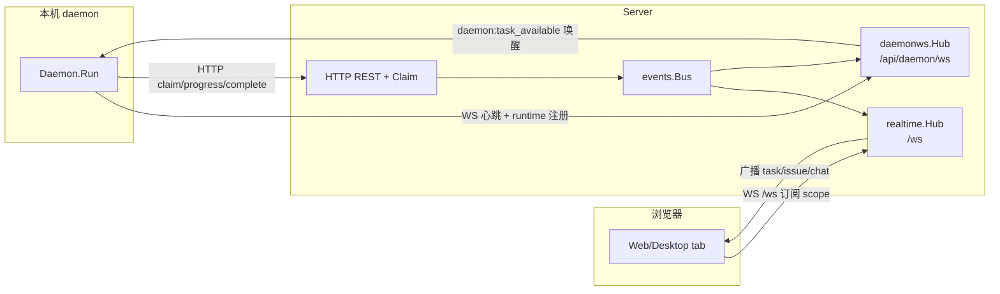
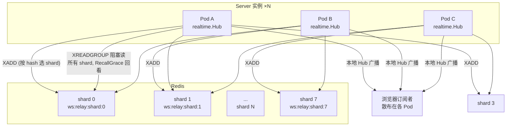
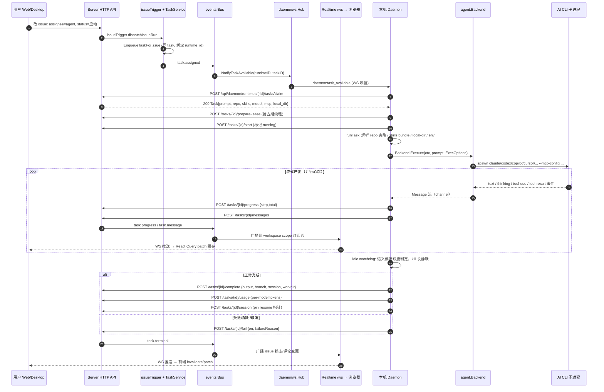
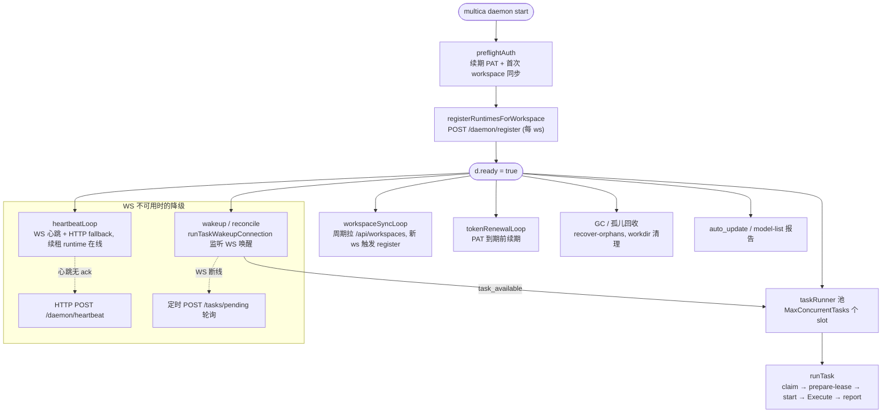
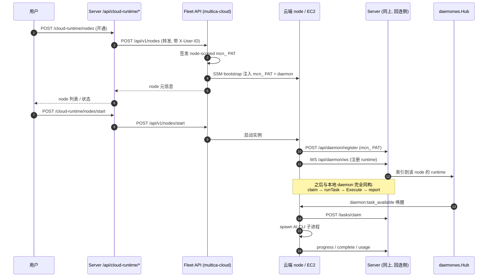

# Multica 运行架构总览

> 本文档用 Mermaid 图描述 Multica 的整体运行架构，重点放在**与服务器各端的交互**和 **Agent Runtime 的调用细节**。配置项、部署细节一律略过。
>
> 受众：想快速理解"前端怎么到后端、task 怎么派到 daemon、agent 怎么真正跑起来"的工程师/新同事。
>
> 图中代码引用均指向真实文件，可点击跳转。

---

## 目录

1. [整体运行架构（主图）](#1-整体运行架构主图)
2. [两路 WebSocket 分工](#2-两路-websocket-分工)
3. [Realtime 多实例 Redis Relay](#3-realtime-多实例-redis-relay)
4. [Agent Runtime 单次任务调用时序](#4-agent-runtime-单次任务调用时序)
5. [Daemon 主循环子阶段](#5-daemon-主循环子阶段)
6. [Agent Backend 统一抽象](#6-agent-backend-统一抽象)
7. [Cloud Runtime 开通与回连](#7-cloud-runtime-开通与回连)
8. [关键交互点速查](#8-关键交互点速查)

---

## 1. 整体运行架构（主图）



要点：

- **两种 Agent Runtime 形态**对 server 协议透明：本机 `multica daemon` 与云端 node 都走同一套 register / claim / heartbeat / task，差别只在本机还是 EC2。
- **正确性靠 HTTP claim**，不靠 WS。WS 唤醒只是"可能有活"的提示，真正抢占是 `POST /tasks/claim`，保证多 daemon / 多 server 实例下任务不重复执行。
- **`events.Bus` 是中枢**：task 终态、progress、评论变更都进 Bus，再分发给 daemon WS 投递和 realtime 浏览器广播。

---

## 2. 两路 WebSocket 分工

Multica 有两条独立的 WebSocket 通道，职责完全不重叠：

| | 浏览器侧 `/ws` | Daemon 侧 `/api/daemon/ws` |
|---|---|---|
| 实现 | [`realtime.Hub`](../server/internal/realtime/hub.go) | [`daemonws.Hub`](../server/internal/daemonws/hub.go) |
| 连接方 | Web / Desktop | 本机 daemon / 云端 node daemon |
| 鉴权 | 用户会话 cookie / PAT | daemon PAT + runtime IDs |
| 索引维度 | user × workspace × scope(task/chat) | runtime ID × workspace |
| 主要帧 | task 进度、issue/评论变更、chat 消息 | `daemon:task_available`、`daemon:runtime_profiles_changed`、心跳 |
| 投递方向 | server → 浏览器（订阅广播） | server → daemon（唤醒提示） |



核心约束：daemon WS 下发的是**唤醒提示**，daemon 收到后仍要打 HTTP `claim` 才拿得到任务；这样即使 WS 丢帧、多 daemon 抢同一任务，最终只有一个能 claim 成功。

---

## 3. Realtime 多实例 Redis Relay

单机部署时 realtime 直接进程内广播；多实例部署时引入 Redis Stream 分片 relay，保证任一 server 实例发出的帧所有实例的订阅者都能收到。



机制要点（见 [`sharded_stream_relay.go`](../server/internal/realtime/sharded_stream_relay.go) / [`redis_relay.go`](../server/internal/realtime/redis_relay.go)）：

- 固定 8 个 shard，key `ws:relay:shard:N`；发布按 `hash(scopeID) % shards` 选 shard。
- 每个 Pod 起**所有 shard 的阻塞 reader** —— 任意 Pod 发的帧，所有 Pod 都能读到并广播给本地订阅者。
- reader 启动从 `(now - ReplayGrace)` 回看，保证 Pod 重启期间漏掉的帧能补播；stream 有 `MAXLEN` 上界，下游消费必须幂等。
- 本地 Hub 端有 event-id 去重，同一帧不会被重复推给同一订阅者。

---

## 4. Agent Runtime 单次任务调用时序

这是"用户给 issue 指派 agent → agent 真的跑起来 → 结果回到前端"的完整时序，最值得反复对照。



关键点：

- **唤醒 → claim 是两步**：WS 唤醒只让 daemon 去轮询，`claim` 才原子地把 task 标给这个 runtime。
- **prepare-lease** 是 claim 之后、start 之前的抢占保护期，runTask 启动慢（克隆 repo、装 skills）时靠它续命，防止被另一个 daemon 抢走。
- **流式事件双向出**：CLI 的每条事件既走 daemon 回报（`progress`/`messages`）进 `events.Bus`，又由 realtime `/ws` 推给浏览器，所以前端能看到 agent 在干啥。
- **resume 指针**：`POST /tasks/{id}/session` 在完成时 pin 住 session，下次同 issue 再触发可 `resumeSessionID` 续跑。

---

## 5. Daemon 主循环子阶段

`multica daemon start` 后 [`Daemon.Run`](../server/internal/daemon/daemon.go#L724) 是一个长生命周期循环，由若干子循环并发构成。



设计取舍：

- **WS 优先、HTTP 兜底**：心跳和任务唤醒都优先走 WS，丢 ack 才回退 HTTP，降低 server 负载又不丢正确性。
- **task slot 池**：`MaxConcurrentTasks` 控制并发，每个 slot 独立跑一次 `runTask`；claim 失败（被抢/无任务）就回睡眠等下一轮唤醒。
- **孤儿回收**：daemon 重启或崩溃前正在跑的 task，靠 `recover-orphans` 把它们标记回 pending，避免永久卡死。

---

## 6. Agent Backend 统一抽象

[`server/pkg/agent`](../server/pkg/agent/agent.go) 把 16 种编码 CLI 收敛成一个 `Backend` 接口，`runTask` 只对接这个接口 —— 加新 CLI 不动调度链。

```mermaid
classDiagram
  class Backend {
    <<interface>>
    +Execute(ctx, prompt, opts ExecOptions) Session
  }
  class ExecOptions {
    +Cwd string
    +Model string
    +SystemPrompt string
    +ThreadName string
    +MaxTurns int
    +Timeout Duration
    +SemanticInactivityTimeout Duration
    +ResumeSessionID string
    +ExtraArgs []string
    +CustomArgs []string
    +McpConfig json.RawMessage
    +ThinkingLevel string
    +OpenclawMode string
  }
  class Session {
    +Messages ~chan~Message
    +Result ~chan~Result
  }
  class Message {
    +Type MessageType
    +Content string
    +Tool string
    +CallID string
    +Input map
    +Output string
    +Status string
    +SessionID string
  }
  class Result {
    +Status string
    +Output string
    +Error string
    +DurationMs int64
    +SessionID string
    +Usage map~string,TokenUsage~
  }

  Backend <|.. Claude
  Backend <|.. Codex
  Backend <|.. Copilot
  Backend <|.. Cursor
  Backend <|.. Hermes
  Backend <|.. Dimcli
  Backend <|.. Openclaw
  Backend <|.. Opencode
  Backend <|.. Others["Kimi·Kiro·Pi·Qoder·Traecli·Codebuddy·Antigravity"]

  Backend ..> ExecOptions
  Backend ..> Session
  Session ..> Message
  Session ..> Result
```

- `agent.New(type)` 按 `SupportedTypes` 白名单选具体后端；白名单与 DB `runtime_profile.protocol_family` CHECK 约束同源。
- 自定义 runtime profile 只覆盖 `ExecutablePath + CustomArgs`，protocol_family 仍决定走哪个 backend 的参数注入逻辑。
- 所有后端的输出都归一成 `Message` 事件流 + `Result` 终态，daemon 侧的进度回报 / usage 统计因此与具体 CLI 解耦。

---

## 7. Cloud Runtime 开通与回连

云端 node 不是另一套协议：server 只代理 fleet 管理 node 生命周期，node 起来后自带 daemon 用 node-scoped `mcn_` PAT 回连，对 server 完全透明。



安全取舍（见 [`cloud_runtime.go`](../server/internal/handler/cloud_runtime.go) / [`cloudruntime/client.go`](../server/internal/cloudruntime/client.go)）：

- server **不转发**用户的 `mul_` PAT 给 fleet，node 用自己独立的 `mcn_` PAT 回连，单 node 被攻破不波及用户长期凭证。
- server 对 fleet 的调用全程带 `X-User-ID` / `X-Request-ID`，并有 op 维度的请求指标（provision / terminate / status / gateway）。
- node 回连后走**完全相同的 daemon 协议**，所以前文时序图对云端 node 同样成立。

---

## 8. 关键交互点速查

| 交互 | 端点 / 通道 | 方向 | 用途 |
|---|---|---|---|
| 浏览器订阅 | `WS /ws` | server → 浏览器 | task/issue/chat 实时推送 |
| Daemon 注册 | `POST /api/daemon/register` | daemon → server | 上报 runtime 列表/模型/skills |
| Daemon 心跳 | `POST /api/daemon/heartbeat` + `WS` | daemon ↔ server | 续租在线态, 兜底降级 |
| 任务唤醒 | `daemon:task_available` (WS) | server → daemon | "可能有活"的提示 |
| 任务抢占 | `POST .../tasks/claim` | daemon → server | 原子认领, 唯一执行者 |
| 进度回报 | `POST .../tasks/progress` `/messages` | daemon → server | 流式状态回到 events.Bus |
| 终态回报 | `POST .../tasks/complete` `/fail` `/usage` | daemon → server | 结束 + token 统计 |
| Cloud 开通 | `POST /api/cloud-runtime/nodes` | server → fleet | 起 EC2 node |
| Cloud 回连 | `POST /api/daemon/register` (mcn_ PAT) | node → server | 回连成普通 daemon |

一句话总结架构：**前端走 REST + `/ws` 看结果，daemon 走 REST + `/api/daemon/ws` 干活，两者由 `events.Bus` + Redis relay 串起来；agent 真正执行是 daemon 用统一 `Backend` 接口 spawn 本机 / 云端 CLI 子进程，云端 node 只是把同一套 daemon 协议搬到了 EC2。**
