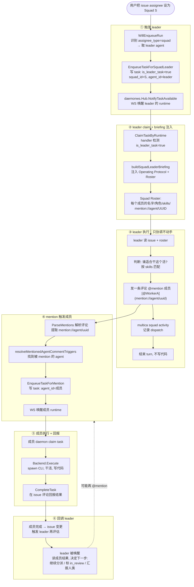

# Squad 分工机制详解

> **问题**：一个复杂任务分配给一个小队（squad），里面有 leader 和各种成员，系统怎么安排分工？为什么这么设计？代码在哪里？
>
> 本文回答三个问题：**怎么分**、**为什么这么分**、**代码在哪**。

---

## 目录

1. [一图看懂 squad 分工全流程](#1-一图看懂-squad-分工全流程)
2. [分工链路逐步拆解](#2-分工链路逐步拆解)
3. [为什么这么设计](#3-为什么这么设计)
4. [代码索引](#4-代码索引)

---

## 1. 一图看懂 squad 分工全流程



---

## 2. 分工链路逐步拆解

### ① 触发 leader：assignee=squad 只唤醒 leader，不唤醒所有成员

用户把 issue 的 assignee 设为 Squad S。系统不会同时唤醒所有成员——**只唤醒 leader**。

**触发决策**（[`issue_trigger.go:165`](../server/internal/service/issue_trigger.go#L165)）：

```go
case "squad":
    squad := GetSquadInWorkspace(...)      // 取 squad 配置
    leader := GetAgent(squad.LeaderID)      // 取 leader agent
    verdict := AgentReadiness(leader)       // 检查 leader 的 runtime 在线
    if !verdict.Ready() { return false }    // 不在线就不入队
    return IssueRunTrigger{
        AssigneeType: "squad",
        AgentID:      squad.LeaderID,       // ← 只写 leader 的 agent_id
    }
```

**入队**（[`handler/squad.go:1175`](../server/internal/handler/squad.go#L1175)）：调 `EnqueueTaskForSquadLeaderWithHandoff`，写一行 task，标 `is_leader_task=true, squad_id=S, agent_id=leader`。

> **关键**：成员此刻完全不知情。task 行里只有 leader 的 agent_id，成员的 runtime 收不到唤醒。

### ② Leader claim：server 注入"球队花名册"

Leader 的 daemon 收到唤醒 → HTTP claim。server handler 检测到 `is_leader_task=true`，**在 claim 响应里注入 briefing**（[`daemon.go:2273`](../server/internal/handler/daemon.go#L2273)）：

```go
if task.IsLeaderTask {
    squad := GetSquadInWorkspace(task.SquadID)
    if uuidToString(squad.LeaderID) == resp.Agent.ID {
        briefing := buildSquadLeaderBriefing(ctx, q, squad, ownsIssueStatus)
        resp.Agent.Instructions += briefing   // 追加到 agent 指令
    }
}
```

Briefing 有三段（[`squad_briefing.go:180`](../server/internal/handler/squad_briefing.go#L180)）：

**第一段——Operating Protocol**（系统级行为约束，L23）：
```
你是 squad LEADER。你的职责是协调，不是自己干。
1. 读 issue, 按 skills 匹配成员
2. @mention 选中的成员, 只说要做什么
3. 记录决策 (multica squad activity)
4. 派完活就停, 不写代码
5. 被唤醒时重新评估
```

**第二段——Squad Roster**（动态生成的花名册，L197）：
```
## Squad Roster

Leader (you):
- CoordinatorBot — agent — [@CoordinatorBot](mention://agent/uuid1)

Members:
- FrontendBot — agent, role: "前端" — skills: react, css — [@FrontendBot](mention://agent/uuid2)
- BackendBot — agent, role: "后端" — skills: go, sql — [@BackendBot](mention://agent/uuid3)
- Alice — member (human), role: "PM" — [@Alice](mention://member/uuid4)
```

每行都带**可直接复制粘贴的 mention 链接** `[@Name](mention://agent/UUID)`。Leader 只需要往评论里贴这个链接就能触发对应成员。

**第三段——Squad Instructions**（用户自定义的小队指令，L186）：

> **为什么在这个阶段注入而不是注册时？** 因为 leader 的身份是 **per-task** 角色而非永久属性——同一个 agent 可能这次当 leader、下次当 worker。briefing 只在 `is_leader_task=true` 的 task claim 时注入，普通 mention task 不注入。task 行上的 `is_leader_task + squad_id` 是唯一的角色信号（[`prompt.go:733`](../server/internal/daemon/prompt.go#L733)）。

### ③ Leader 执行：只协调，不动手

Leader agent 被 CLI 唤醒后，拿到的 system prompt 里包含 Operating Protocol + Roster。它的行为被约束为：

1. **读 issue**——标题、描述、评论、验收标准
2. **按 skills 匹配**——Roster 里列了每个成员的 skills，leader 选最匹配的
3. **发一条评论 @mention 成员**——用 Roster 里的 mention 链接
4. **记录决策**——`multica squad activity <issue-id> action --reason "..."`
5. **停手**——不写代码、不开文件，等下一次被唤醒

协议里写得很硬（[`squad_briefing.go:120`](../server/internal/handler/squad_briefing.go#L120)）：
```
Hard rules:
- EVERY delegation MUST use the full mention markdown syntax
- Do NOT do the implementation work yourself unless the squad has no other suitable members
- One delegation comment per turn is enough
```

> **为什么不让 leader 直接干？** 如果 leader 自己干活，squad 就退化成单个 agent。分工的价值是并行执行 + 专业匹配：FrontendBot 懂前端、BackendBot 懂后端，leader 只管调度。

### ④ Mention 触发成员：评论解析 → task 入队

Leader 发的评论 `[@FrontendBot](mention://agent/uuid2)` 触发成员 agent 的 task。

**评论创建后**（[`comment.go:2653`](../server/internal/handler/comment.go#L2653)）：

```go
func computeCommentAgentTriggers(ctx, issue, content, ...) {
    mentions := util.ParseMentions(content)   // 解析 mention:// 链接

    if hasAgentOrSquadMention(mentions) {
        return resolveMentionedAgentCommentTriggers(ctx, issue, mentions, ...)
    }
    // ...其他隐式路由（assignee fallback、thread parent 等）
}
```

**mention → agent 解析**（[`comment.go:3023`](../server/internal/handler/comment.go#L3023)）：

```go
for _, m := range mentions {
    if m.Type == "agent" {
        agent := GetAgentInWorkspace(m.ID)     // 找到被 mention 的 agent
        // 权限检查: 私有 agent 只有 owner/admin 能 mention
        // pending 去重: HasPendingTaskForIssueAndAgent
        triggers = append(triggers, commentAgentTrigger{Agent: agent, ...})
    }
    if m.Type == "squad" {
        squad := GetSquadInWorkspace(m.ID)
        triggers = append(triggers, commentAgentTrigger{Agent: squad.Leader, ...})
    }
}
```

**入队**（[`comment.go:2609`](../server/internal/handler/comment.go#L2609)）：

```go
h.TaskService.EnqueueTaskForMention(ctx, issue, trigger.Agent.ID, triggerCommentID)
```

> **为什么用 mention 而不是 server 直接派？** 因为分工决策是 **AI 的活**，不是 server 硬编码的。server 不知道哪个成员适合哪个子任务——leader 看了 issue 内容才知道。mention 是 leader 把"用人决策"传回 server 的机制：server 只负责把 mention 翻译成 task 行。

### ⑤ 成员执行：与普通 agent task 完全一样

成员的 daemon claim 到 task → `runTask` → `Backend.Execute` → spawn CLI 子进程。**没有 briefing 注入**，因为 `is_leader_task=false`。

成员干完活后：
- `CompleteTask` 在 issue 上发评论回报结果
- `ReportTaskUsage` 上报 token 用量

### ⑥ 回调 leader：成员完成后自动唤醒 leader 再评估

成员完成后，issue 状态/评论发生变化。如果 parent issue 的 assignee 是 squad，系统**自动唤醒 leader 再评估**。

**回调路径**（[`issue_child_done.go:698`](../server/internal/handler/issue_child_done.go#L698)）：

```go
func triggerChildDoneSquad(ctx, parent, triggerCommentID) {
    squad := GetSquadInWorkspace(parent.AssigneeID)
    agent := GetAgent(squad.LeaderID)
    // 注意: 无自触发保护, 无 invocation gate (注释解释了为什么去掉)
    h.TaskService.EnqueueTaskForSquadLeader(ctx, parent, squad.LeaderID, squad.ID, triggerCommentID)
}
```

Leader 被唤醒后，读成员的结果评论，决定：
- 继续分派下一步给另一个成员
- 标 issue 为 `in_review`（如果 ownsIssueStatus=true）
- 向人类报告问题
- `no_action`——无需响应（成员只是发了进度更新），记录后静默退出

> **为什么去掉自触发保护？** 注释（L673）解释：之前同 squad 的子 issue 完成后会阻止唤醒 leader，但子 issue 完成是在**子 issue 上的 wake**，leader 从未看到 parent 级别的阶段屏障指令。去掉后，agent 和 squad 的 child-done 走同一条路径，避免 process-squad 流水线卡死。

---

## 3. 为什么这么设计

### 3.1 为什么 leader 只协调不干活？

| 方案 | 问题 |
|---|---|
| Leader 自己干 | squad 退化成单 agent，无并行、无专业匹配 |
| Server 硬编码分工 | server 不知道 issue 内容，无法判断谁适合干 |
| **Leader 读 issue 后 @mention 分派** | **AI 做分工决策 + server 做机制保证** |

分工决策需要理解 issue 内容——这是 AI 的强项。server 只提供机制（mention 解析、task 入队、去重、回调），不做内容判断。

### 3.2 为什么用 mention 而不是子 issue？

Protocol 明确说（[`squad_briefing.go:144`](../server/internal/handler/squad_briefing.go#L144)）：

```
- A child issue you create with --status todo and an agent assignee
  already fires that agent automatically — the assignment IS the trigger.
  If you also @mention the same agent on this parent issue for the same
  work, the agent runs twice in parallel. Pick exactly one path.
```

两条路都能派活，**不能同时用**：

- **@mention**：轻量，适合"在这个 issue 上做某事"，成员在同一个 issue 上下文里工作
- **子 issue**：重，适合"拆成独立子任务"，成员在子 issue 上下文里工作，完成后回调 parent

leader 按任务复杂度选择。简单任务 mention，需要独立追踪的子任务建子 issue。

### 3.3 为什么 briefing 在 claim 时注入而不是注册时？

Leader 身份是 **per-task** 角色：

```go
// prompt.go:733
func taskIsSquadLeader(task Task) bool {
    if !task.LeaderRoleResolved {
        // 兼容旧 server: 嗅探 Instructions 里的 marker
        return strings.Contains(task.Agent.Instructions, squadBriefingMarker)
    }
    return task.IsLeaderTask || task.SquadID != ""
}
```

同一个 agent（比如 CoordinatorBot）可能：
- 这次 task 当 squad S 的 leader（`is_leader_task=true`）→ 注入 briefing
- 下次 task 被 @mention 当 squad S 的 worker（`is_leader_task=false`）→ 不注入

如果在注册时永久注入，worker run 就会错误地执行 leader 协议。

### 3.4 为什么自触发保护只防 leader 不防 worker？

Leader 给自己 @mention 会形成循环（leader → mention 自己 → leader 再 mention…）。保护逻辑（[`squad.go:1132`](../server/internal/handler/squad.go#L1132)）：

```go
func shouldSuppressSquadLeaderSelfTrigger(ctx, issueID, leaderID, squadID) bool {
    latest := GetLatestTaskRoleForIssueAndAgent(issueID, leaderID)
    if latest.IsLeaderTask { return true }  // 上一轮就是 leader, 不再自触发
    return latest.SquadID != squadID        // 上一轮在别的 squad, 不自触发
}
```

但 **child-done 回调不防**（[`issue_child_done.go:673`](../server/internal/handler/issue_child_done.go#L673)）：因为成员完成了，leader 必须被唤醒来推进下一阶段——这不是循环，是流水线。

### 3.5 为什么用 pending 去重而不是锁？

```go
// issue_trigger.go:206
func hasPendingRun(ctx, issueID, agentID) bool {
    pending := HasPendingTaskForIssueAndAgent(issueID, agentID, headSha)
    return pending   // 已有 pending task 就不再入队
}
```

不去锁 task 行，而是查"有没有 pending"。多个触发源（assign、comment mention、child-done）可能同时到达，但 `(issue_id, agent_id)` 只有一个 pending 行能存活——DB 唯一约束兜底。

> **HeadSha 参与去重**：防止 PR 代码更新后旧 pending task 阻挡新 run。HEAD 变了 → 旧 pending 作废 → 新 run 入队。

---

## 4. 代码索引

### 触发

| 逻辑 | 文件:行 |
|---|---|
| squad 触发决策 | [`service/issue_trigger.go:165`](../server/internal/service/issue_trigger.go#L165) |
| leader 入队（assign/path） | [`handler/squad.go:1175`](../server/internal/handler/squad.go#L1175) |
| leader 入队（service） | [`service/task.go:1300`](../server/internal/service/task.go#L1300) |
| leader 入队 + handoff | [`service/task.go:1309`](../server/internal/service/task.go#L1309) |
| mention 入队 | [`service/task.go:1279`](../server/internal/service/task.go#L1279) |
| 入队共享实现 | [`service/task.go:1313`](../server/internal/service/task.go#L1313) |

### Briefing 注入

| 逻辑 | 文件:行 |
|---|---|
| claim 时检测 leader task | [`handler/daemon.go:2273`](../server/internal/handler/daemon.go#L2273) |
| briefing 组装 | [`handler/squad_briefing.go:180`](../server/internal/handler/squad_briefing.go#L180) |
| Operating Protocol 头部 | [`handler/squad_briefing.go:23`](../server/internal/handler/squad_briefing.go#L23) |
| parent status 责任（owns） | [`handler/squad_briefing.go:97`](../server/internal/handler/squad_briefing.go#L97) |
| parent status 责任（guest） | [`handler/squad_briefing.go:113`](../server/internal/handler/squad_briefing.go#L113) |
| 硬规则 | [`handler/squad_briefing.go:120`](../server/internal/handler/squad_briefing.go#L120) |
| Squad Roster 渲染 | [`handler/squad_briefing.go:197`](../server/internal/handler/squad_briefing.go#L197) |
| 成员 skill 查询 | [`handler/squad_briefing.go:245`](../server/internal/handler/squad_briefing.go#L245) |
| 成员行渲染 | [`handler/squad_briefing.go:279`](../server/internal/handler/squad_briefing.go#L279) |
| mention 格式化 | [`handler/squad_briefing.go:350`](../server/internal/handler/squad_briefing.go#L350) |
| quick-create 路径注入 | [`handler/daemon.go:2966`](../server/internal/handler/daemon.go#L2966) |

### Mention 派发

| 逻辑 | 文件:行 |
|---|---|
| 评论触发计算 | [`handler/comment.go:2653`](../server/internal/handler/comment.go#L2653) |
| mention 解析正则 | [`util/mention.go:24`](../server/internal/util/mention.go#L24) |
| @agent/@squad 路由 | [`handler/comment.go:3023`](../server/internal/handler/comment.go#L3023) |
| @squad → leader 转换 | [`handler/comment.go:3081`](../server/internal/handler/comment.go#L3081) |
| squad leader fallback | [`handler/comment.go:2934`](../server/internal/handler/comment.go#L2934) |
| mention → task 入队 | [`handler/comment.go:2609`](../server/internal/handler/comment.go#L2609) |
| squad mention → leader 入队 | [`handler/comment.go:2588`](../server/internal/handler/comment.go#L2588) |

### 回调与去重

| 逻辑 | 文件:行 |
|---|---|
| child-done → agent 回调 | [`handler/issue_child_done.go:646`](../server/internal/handler/issue_child_done.go#L646) |
| child-done → squad 回调 | [`handler/issue_child_done.go:698`](../server/internal/handler/issue_child_done.go#L698) |
| child-done 评论 | [`handler/issue_child_done.go:272`](../server/internal/handler/issue_child_done.go#L272) |
| leader 自触发保护 | [`handler/squad.go:1132`](../server/internal/handler/squad.go#L1132) |
| pending 去重 | [`service/issue_trigger.go:206`](../server/internal/service/issue_trigger.go#L206) |
| comment pending 检查 | [`handler/comment.go:2963`](../server/internal/handler/comment.go#L2963) |
| no_action 评估记录 | [`service/squad_no_action.go:12`](../server/internal/service/squad_no_action.go#L12) |
| evaluation 上报 | [`handler/squad.go:961`](../server/internal/handler/squad.go#L961) |

### Daemon 侧

| 逻辑 | 文件:行 |
|---|---|
| leader 角色判定 | [`daemon/prompt.go:733`](../server/internal/daemon/prompt.go#L733) |
| briefing marker（兼容） | [`daemon/prompt.go:706`](../server/internal/daemon/prompt.go#L706) |
| squad prompt 生成 | [`daemon/prompt.go:253`](../server/internal/daemon/prompt.go#L253) |
| squad activity 指令 | [`daemon/prompt.go`](../server/internal/daemon/prompt.go) |

### CRUD

| 逻辑 | 文件:行 |
|---|---|
| 创建 squad | [`handler/squad.go:227`](../server/internal/handler/squad.go#L227) |
| 添加成员 | [`handler/squad.go:752`](../server/internal/handler/squad.go#L752) |
| 成员状态列表 | [`handler/squad.go:639`](../server/internal/handler/squad.go#L639) |
| 成员状态推导 | [`handler/squad.go:606`](../server/internal/handler/squad.go#L606) |
| 更新成员角色 | [`handler/squad.go:897`](../server/internal/handler/squad.go#L897) |
| 删除 squad | [`handler/squad.go:483`](../server/internal/handler/squad.go#L483) |
